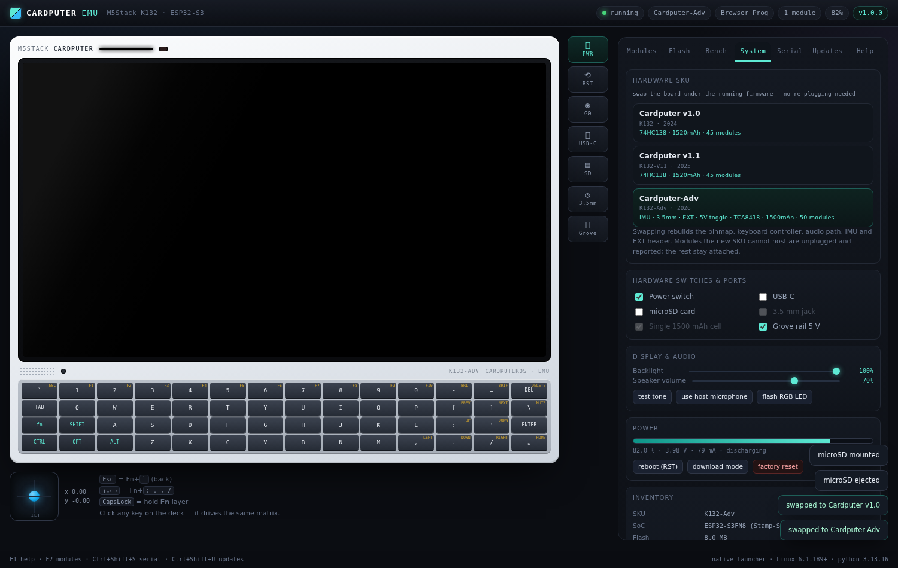
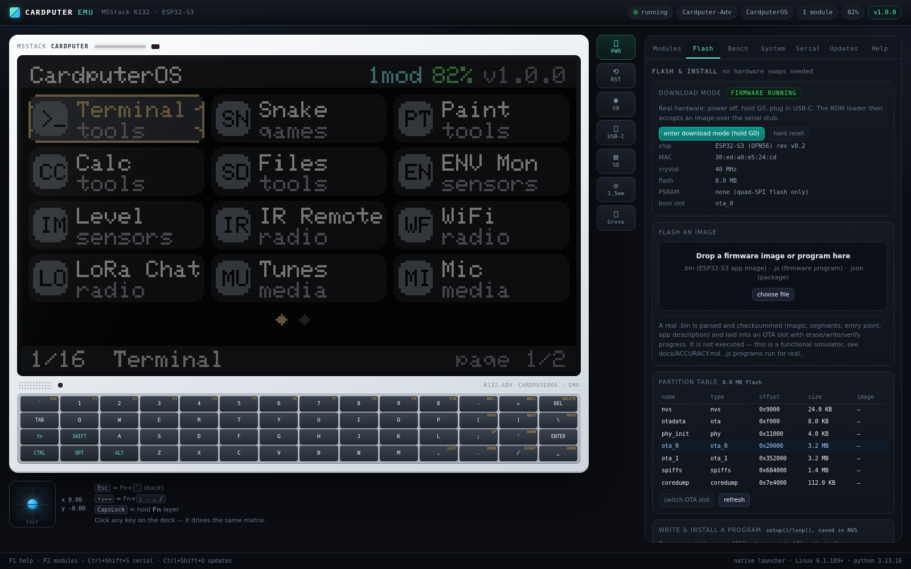
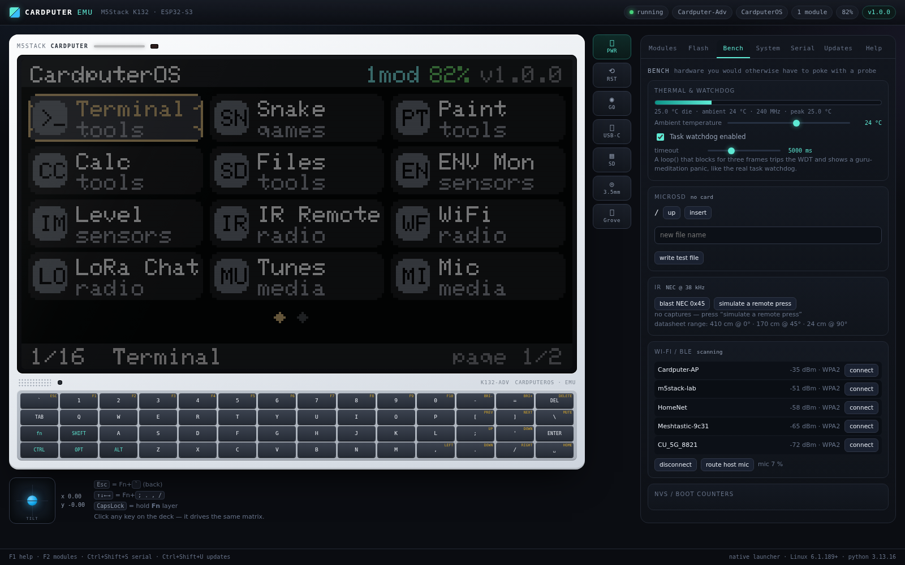
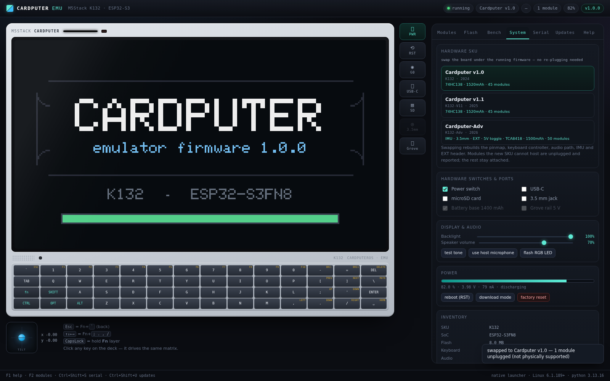

# Cardputer EMU

A cross-platform emulator for the **M5Stack Cardputer** (K132 family: v1.0, v1.1 and
Cardputer-Adv). It models the actual hardware — 240×135 ST7789V2 LCD, the 56-key
matrix, codec/speaker/mic, BMI270 IMU, IR blaster, microSD, Wi-Fi/BLE, the battery and
charger — and it has a **hot-pluggable Grove / EXT module rack** so you can add and
remove real M5Stack units while firmware is running.

Runs on **Linux, Windows and macOS** with nothing but Python 3.9+ (standard library
only — no pip installs, no build step, no native binaries). It also builds to a single
self-contained HTML file you can open anywhere.

```
   ___             _            _              _____ __  __ _   _
  / __\ __ _ _ __| |_ _ __  ___| |_ ___ _ __  | ____|  \/  | | | |
 / / |/ _` | '__| __| '_ \/ __| __/ _ \ '__| |  _| | |\/| | | | |
/ /__| (_| | |  | |_| |_) \__ \ ||  __/ |    | |___| |  | |_| |_|
\____/\__,_|_|   \__| .__/|___/\__\___|_|    \____|_|  |_|\___/
                    |_|   M5Stack Cardputer emulator
```



| Flash & install | Bench | SKU swap |
| --- | --- | --- |
|  |  |  |

---

## Install

Two ways, both offline, both without pip / node / admin rights.

**1 — the release zip (recommended)**

Unzip it anywhere (Desktop, USB stick, home folder) and start the installer:

| Platform | Install | Then run |
| --- | --- | --- |
| **Windows** | double-click `install.bat` | double-click `run.bat` |
| **macOS** | double-click `install.command` | double-click `run.command` |
| **Linux** | double-click `install.sh` — or `python3 install.py` | `./run.sh` |

The installer walks six steps and prints them as it goes:

```
[1/6] Python runtime          3.9+ check, reports interpreter and platform
[2/6] Runtime data directory  creates data/config.json (channel, port, portable mode)
[3/6] UI bundle               builds cardputer.html from src/ — skipped when current
[4/6] Launcher shortcut       desktop / Start-menu / .command entry (optional)
[5/6] Self-test               imports the package, checks the bundle markers, probes the
                              module catalog, boots the real server, reads /api/info,
                              fetches the page, and drives it in headless Chromium when
                              Playwright is available
[6/6] Done                    prints the exact command to start the emulator
```

The UI is created **as needed**: `cardputer.html` is built from `src/` when it is
missing *or* older than the sources/the release feed, and the installer falls back to a
shipped bundle if the build cannot run. Non-zero exit codes say exactly what broke —
`2` Python too old, `3` data directory, `4` the UI could not be created, `5` self-test
warnings. Useful flags: `--yes --launch --port N --rebuild --no-shortcuts --skip-test
--portable`.

**2 — from the sources**

```bash
python3 install.py          # or just: python3 build.py && python3 run.py
```

Either way you end up with the same thing: a launcher, a local server on
`http://127.0.0.1:8787/`, and `cardputer.html` — the whole emulator in one file that
runs straight from disk with no server at all.

---

## Quick start

Requires **Python 3.9+**. Nothing else.

| Platform | Run it |
| --- | --- |
| **Linux** | `./run.sh`  or  `python3 run.py` |
| **macOS** | double-click `run.command`  or  `python3 run.py` |
| **Windows** | double-click `run.bat`  or  `py -3 run.py` |

The launcher checks the release feed, builds the bundle if needed, starts a local
server and opens your browser at `http://127.0.0.1:8787/`.

```
python run.py                start the emulator
python run.py --check        ask the release feed for updates and list the notes
python run.py --update       download + verify (SHA-256) + install an update
python run.py --rollback     restore the previous build
python run.py --status       print version, channel, catalog, snapshots
python run.py --dev          serve src/ unbundled (live editing of the UI)
python run.py --port 9000 --no-browser --channel beta
```

Prefer no Python at all? **`cardputer.html`** is a single self-contained file —
double-click it and the emulator runs in any modern browser (core updates are then
disabled, but the module catalog and firmware apps still update from the feed).

---

## What you get

* **A real device model, not a mock-up.** Firmware draws into an RGB565 framebuffer
  with an Adafruit-GFX-style API; the keyboard is an actual 4×14 scan matrix with an
  Fn layer and auto-repeat; peripherals live on emulated I²C / SPI / UART / GPIO buses
  that NAK when a device disappears.
* **Three SKUs, swapped live.** `System → Hardware SKU` re-runs the board model:
  pinmap, keyboard controller, audio path, IMU, 3.5 mm jack and the EXT header are
  rebuilt, modules the new SKU cannot physically host are unplugged with a reason, and
  everything else stays on its bus. See [docs/MODULES.md](docs/MODULES.md).
* **The module rack.** **50** module drivers — Grove Units *and* Cardputer CAPs — with
  real part numbers, I²C addresses, UART protocols (NMEA, Modbus RTU, AT, PMS), live
  state and *injectable* physical controls, plus address/pin/rail conflict detection:
  a Unit ToF (`0x29`) blocks a ToF4M (`0x29`), an EXT CAP refuses to attach on a v1.0,
  and a 5 V-only unit will not power up on the Adv unless the Grove rail is at 5 V.
* **Flash & install without touching hardware.** A Flash tab with the ESP32-S3
  partition table, ROM download mode (hold G0), drag-and-drop firmware images that are
  parsed/checksummed/laid into an OTA slot with erase-write-verify progress, an NVS
  store, and a program editor: write a `setup()`/`loop()` app, hit *install & run*, and
  it persists across reloads. See [docs/FLASH.md](docs/FLASH.md).
* **A bench you would otherwise need a probe for.** Die-temperature and throttle
  model, task watchdog with a guru-meditation panic, microSD browser, IR capture/replay
  with the datasheet range table, Wi-Fi/BLE scan, microphone level, Grove 5 V rail.
* **17 firmware apps** (launcher, shell, Snake, Paint, Calc, Files, ENV monitor, level,
  IR remote, Wi-Fi, LoRa chat, tunes, mic scope, key test, system) each written as
  `setup()` / `loop()` exactly like Arduino sketches, plus a Weather app that only
  exists once you install the v1.1.0 update — and any program you install yourself.
* **Automatic updates**, hash-verified, with channels, release notes, rollback
  snapshots, and a *soft payload* (catalog + apps) that applies without a restart.
* **Everything observable:** boot ROM log + serial console, I²C scan, battery draw,
  per-module live values, panic screens with a backtrace when an app crashes.

---

## The hardware model

| Subsystem | Emulated as |
| --- | --- |
| SoC | ESP32-S3FN8, dual LX7 @240 MHz, 8 MB flash, 0 PSRAM (as shipped) — no cycle-accurate core |
| Display | ST7789V2, 240×135 RGB565, rotation, backlight PWM, sleep, GIF-style GFX primitives + 5×7 GLCD font |
| Keyboard | 4×14 = 56-key matrix. GPIO scan via 74HC138 (v1.0/v1.1) or TCA8418 I²C expander @`0x34` with a 10-entry event FIFO + INT line (Adv) |
| Audio | NS4168 amp + SPM1423 mic (v1.x) / ES8311 codec @`0x18` + NS4150B amp + 3.5 mm jack detect (Adv). Tones and sample playback go to WebAudio |
| Microphone | Simulated ambience, or route your host mic into the emulated ADC/PDM path |
| IMU | BMI270 @`0x68` (Adv only) — accel/gyro, tilt pad, step counter |
| IR | NEC encoder on GPIO44 → virtual receiver log; click the IR window to blast |
| Storage | microSD over SPI (CS 12 / MOSI 14 / CLK 40 / MISO 39) with a persistent FAT-style FS |
| Radio | 2.4 GHz AP scan with RSSI jitter, connect state machine + DHCP, BLE scan, HTTP via a proxy |
| Power | 1520 mAh dual-cell (v1.x) / 1500 mAh single (Adv), 1S discharge curve with load sag, ~165 mA typing / ~256 mA IR, 0.26 µA sleep, CC/CV charging at ~290 mA, brownout detector at 3.30 V |
| Thermal | Lumped die-temperature model (34 K/W, 55 s τ), ambient slider, 160 MHz throttle above 78 °C |
| Watchdog | Task WDT: firmware loop budget measured per frame, three blown frames → panic + backtrace |
| Flash | 8 MB with nvs / otadata / phy_init / ota_0 / ota_1 / spiffs / coredump, ROM download mode, ESP32-S3 image parser with header-checksum and segment validation |
| Expansion | HY2.0-4P Grove port (G2/G1), EXT 2.54-14P header (G3/G4/G5/G6/G40/G14/G39/G8/G9/G13/G15) |

Pin maps are taken from the M5Stack documentation and are visible in
**System → Inventory**, including the live I\(^2\)C scan of the internal and Grove buses.

---

## Modules: add and remove parts at runtime

Open **Modules** in the right-hand console. The rack has three ports (Grove, EXT, and
the microSD slot) plus the catalog. Plugging a unit:

1. claims its I²C address(es) on the emulated bus (or GPIO pins / UART lines / SPI CS),
2. instantiates its simulator with a live state object,
3. writes `[I][mod] attached ENV III (U001-C) on grove @ 0x44, 0x70` to the serial log.

Unplugging removes it from the bus mid-run, so firmware gets a real NAK and apps have
to cope — the ENV Monitor app keeps re-scanning the bus and wakes up when you plug one
back in.

Every module card has **inject controls** (sliders/buttons/colour pickers) so you can
push the simulated world around: raise the ENV III temperature and the monitor graph
moves; press *Wave a hand* on the PIR and the relay app hears it; drag *Load current* on
the Kmeter and the wattage updates.

Built-in catalog (28 definitions):

| Ecosystem | Modules |
| --- | --- |
| Grove I²C | ENV III `0x44/0x70`, ENV IV `0x44/0x76`, ENV Pro `0x77`, Light `0x23`, Color `0x29`, ToF `0x29`, Thermal `0x33`, Heart `0x57`, Sonic `0x57`, Relay `0x26`, ADC `0x48`, DAC `0x60`, 8Servo `0x40`, JoyC `0x38`, RFID `0x28`, Gesture `0x73`, NCIR `0x5A`, ExtIO `0x20`, CO₂ `0x62`, Accel `0x19`, Kmeter `0x50` |
| Grove GPIO | PIR, Earth moisture, Button, RGB (SK6812), Buzzer |
| Grove UART | GPS (NMEA @9600), LoRaWAN (AT @115200), Fingerprint (@57600) |
| EXT header (Adv only) | CAP LoRa-1262 (SX1262 over SPI), CAP CC1101 |
| On-board | microSD, BMI270, ES8311, TCA8418 |

Conflict rules that are enforced (with the reason shown inline):

* one unit per Grove port, one CAP per EXT header;
* no two devices on the same I²C address (`0x29` ToF vs Color, `0x57` Heart vs Sonic);
* no two GPIO modules on the same pin (PIR vs RGB vs Button);
* CAP modules refuse to attach to a SKU without the EXT header.

Adding your own module is ~20 lines — see [docs/MODULES.md](docs/MODULES.md). Modules can
also be **served from the update feed**, driver source included, so new hardware support
lands without shipping a new emulator build.

---

## Firmware apps

The launcher is a real firmware app; everything else is listed in it (3×4 grid, arrows =
Fn + `; . , /`, ENTER launches, Fn + ` goes back).

| App | What it does |
| --- | --- |
| Terminal | CardputerOS shell: `mod`, `i2c`, `gpio`, `wifi scan/connect`, `sd`, `cat`, `led`, `beep`, `ir`, `app`, `run`, `reboot`, `free`… |
| ENV Mon | Live temperature/humidity/pressure with a 60-sample graph; hot-plug aware |
| Level | BMI270 bubble level (shows the "not present" path on non-Adv SKUs) |
| IR Remote | NEC blaster with a transmit log |
| WiFi | AP scan with RSSI bars, password prompt, DHCP/IP status |
| LoRa Chat | Meshtastic-style chat; refuses to run without a LoRa radio and tells you which port to plug it into |
| Files | microSD browser + text viewer |
| Snake / Paint / Calc / Tunes / Mic / Keys / System | Games, pixel sketcher, calculator, tone sequencer, mic scope, matrix inspector, inventory |
| Weather | Ships in the v1.1.0 update as a soft-payload app |

Apps are ES modules with `setup(api)` / `loop(api, dt)` / optional `onKey`. A crashing
app produces a Guru-Meditation-style panic screen with a fake backtrace, logs the stack
to the serial console, and any key returns to the launcher. See
[docs/APPS.md](docs/APPS.md) for the API.

---

## Automatic updates and upgrades

The emulator ships at **v1.0.0** and the feed already contains **v1.1.0** (stable) and
**v1.2.0-beta.1** (beta). On launch the launcher checks the feed and, if `auto_update`
is on, installs the update silently — you'll see it in the console output and in
**Updates → Updater log**.

What happens during an install:

1. **check** — fetch `updates/manifest.json` (or any https URL), compare semver within
   the channel;
2. **download** — pull the package (local path or URL);
3. **verify** — SHA-256 must match the feed byte-for-byte, otherwise the update is
   refused (unsigned packages are refused too);
4. **stage + snapshot** — unpack to `data/staging/`, back up every file it will replace
   into `data/snapshots/<timestamp>/`;
5. **apply** — copy files in atomically (never touching `data/`), pin `VERSION`;
6. **soft payload** — merge the new module catalog and register any new firmware apps
   immediately, so the Weather app appears without a restart; core bundle changes apply
   at the next launch.

Rollback restores the newest snapshot (`python run.py --rollback`, or the button in the
Updates panel). Channels: `--channel beta` opts into prereleases. The feed URL is
configurable from the UI, so you can point it at your own server or a `file://` path.

Build your own release:

```bash
python tools/make_update.py --version 1.1.1 --channel stable \
  --files updates/catalog.json updates/apps/weather.js \
  --soft '{"catalog":"updates/catalog.json","apps":["updates/apps/weather.js"]}' \
  --note "fix: relay debounce" 
```

That writes `updates/packages/cardputer-emu-1.1.1.zip`, hashes it, and publishes the feed
entry. Full spec: [docs/UPDATES.md](docs/UPDATES.md).

---

## Project layout

```
install.py  install.sh  install.command  install.bat   installer + self-test (round 4)
START-HERE.txt                         plain-text instructions shipped in the zip
run.py  run.sh  run.command  run.bat   cross-platform launchers
build.py                               bundles src/ -> cardputer.html
VERSION                                installed version (the updater rewrites this)
cardputer/                             Python side (stdlib only)
  cli.py                               argument parsing, banner, serve loop
  server.py                            static server + /api/* endpoints
  updater.py                           check / verify / apply / rollback
  config.py                            data/config.json + data/state.json
src/
  index.html  css/emulator.css
  js/core/    util, font (5x7 GLCD), hardware (LCD + keyboard), peripherals, device, flash
  js/modules/ modules.js               catalog + simulators (hot-plug)
  js/rt/      runtime.js               firmware runtime + M5-style API
  js/apps/    apps.js                  15 built-in firmware apps
  js/ui/      chassis.js panels.js updater.js
  js/main.js                           bootstrap + main loop
updates/
  manifest.json  catalog.json  apps/weather.js  packages/*.zip  CHANGELOG.md
tools/make_update.py                   package builder + feed publisher
tools/make_release.py                  packs dist/cardputer-emu-<version>.zip and verifies it
tools/check.py  tools/browser_check.py  quality gate (lint, types, tests, fuzz, build, UI)
tests/                                 test_core.mjs, fuzz_core.mjs, test_updater.py,
                                       fuzz_updater.py, test_install.py (14 installer cases)
docs/                                  MODULES, UPDATES, APPS, FLASH, ACCURACY
data/                                  runtime state, snapshots, downloads (git-ignored)
cardputer.html                          single-file build (open it directly)
```

## Tests

```bash
python3 tools/check.py            # the gate: ruff, tsc, eslint, unit tests, fuzz, build, headless UI
node tests/test_core.mjs          # 36 assertions: LCD, matrix, buses, conflicts, SKU swap, flash, NVS, apps, power
node tests/fuzz_core.mjs --seed 11  # keyboard / hot-plug / SKU-swap / flash / framebuffer + 10k frames
python3 tests/test_updater.py     # 6 tests: semver, check, apply, rollback, tamper, channels
python3 tests/fuzz_updater.py     # 2041 invariants against hostile feeds and archives
python3 tests/test_install.py     # 14 installer cases: clean install, rebuild, stale sources, failure modes
python3 tools/browser_check.py    # drives the real UI: boots, swaps SKUs, installs a program, 0 console errors
```

Release packaging is verified the same way it is used: `python3 tools/make_release.py`
writes `dist/cardputer-emu-1.0.0.zip` (plus a `.sha256`), unzips it into a temp folder and
runs the installer from inside it — the same self-test a user sees, ending with
`headless UI check: ok: … 0 console errors`.

## Notes and limits

* This is a **functional** emulator, not a cycle-accurate ESP32-S3: firmware runs as
  JavaScript against an M5Cardputer-style API rather than Xtensa machine code. That is
  what makes it instant, scriptable and portable — and it is why modules and apps can be
  delivered as plain text by the updater. A real `.bin` is parsed, checksummed and
  flashed into an OTA slot, but it is not executed. [docs/ACCURACY.md](docs/ACCURACY.md)
  spells out exactly where this beats and loses to QEMU/Wokwi and the firmware-compiling
  peer projects.
* Wi-Fi, BLE, GPS and LoRa are simulated at the protocol/behaviour level, not at the RF
  level. HTTP requests are proxied through the launcher when it is available.
* Cardputer, M5Stack, Stamp-S3 and Grove are trademarks of M5Stack; this is an
  unofficial, fan-made emulator and ships no M5Stack binaries or assets.
* The 5×7 glyph data is the classic public-domain Adafruit-GFX / TFT_eSPI GLCD font.
